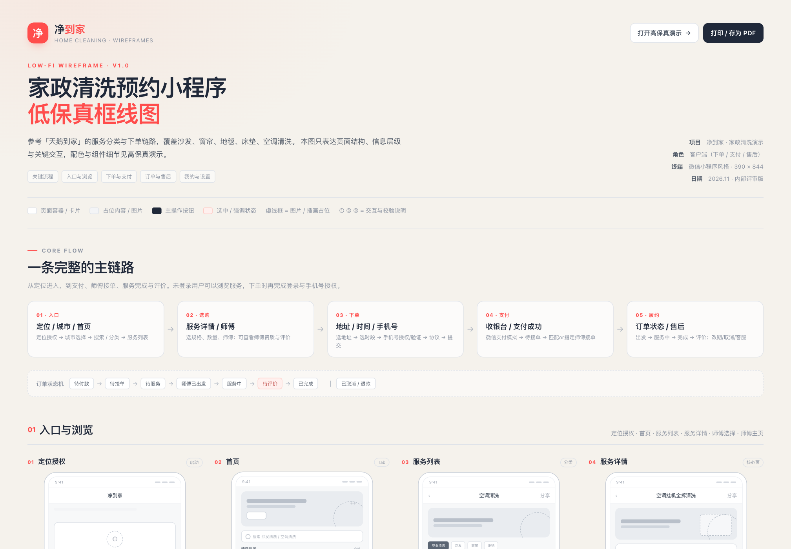
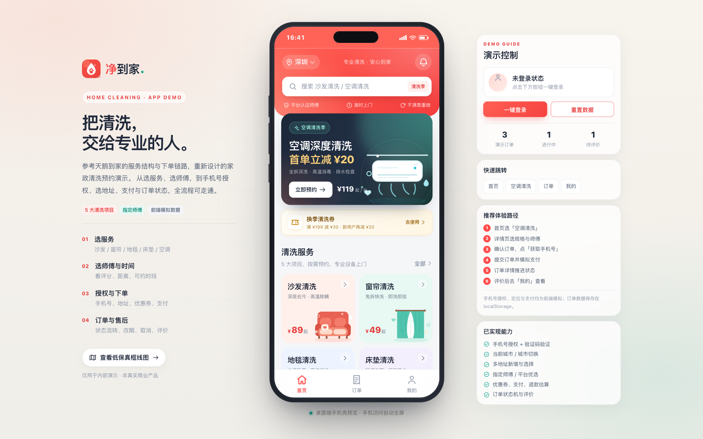
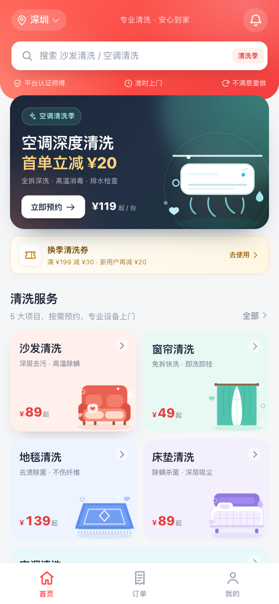

# 净到家 · 家政清洗预约小程序演示

一套**可完整跑通**的家政清洗预约演示，参考「天鹅到家」的服务分类、下单链路、师傅展示与售后规则重新设计。覆盖 **沙发、窗帘、地毯、床垫、空调** 五大清洗项目，客户端可完成：

- 浏览服务、查看服务详情、按规格/数量计价
- 查看师傅并指定师傅（或平台优选）
- 定位当前城市、切换城市、新增/选择多个服务地址
- 微信登录 / 手机号验证码登录
- 模拟小程序 `getPhoneNumber` 获取手机号，支持短信验证码校验
- 选择上门日期与时段、使用优惠券、阅读并同意服务协议
- 提交订单、模拟微信支付
- 查看订单状态流转、联系师傅、改期、取消退款、评价
- 「我的」：订单、优惠券、收藏、地址、消息、协议中心、客服

> 本项目为**前端模拟数据演示**，无后端、无真实支付、不获取真实手机号/位置。所有师傅、价格、评价、协议均为演示内容，非真实商业产品。「天鹅到家」为其权利人商标，本项目仅作产品结构参考。

## 在线演示

- **高保真演示**：<https://abelwangyabo.github.io/jingdaojia-cleaning-demo/>
- **低保真框线图**：<https://abelwangyabo.github.io/jingdaojia-cleaning-demo/wireframes.html>
- **框线图 PDF**：<https://abelwangyabo.github.io/jingdaojia-cleaning-demo/wireframes.pdf>
- **GitHub 仓库**：<https://github.com/AbelWangYaBo/jingdaojia-cleaning-demo>

> 已配置 GitHub Actions 自动构建并部署到 GitHub Pages。推送到 `main` 分支后会自动执行 `pnpm typecheck`、`pnpm build` 并发布 `dist/`。

---

## 快速开始

```bash
pnpm install
pnpm dev
# 打开 http://127.0.0.1:5273
```

生产构建：

```bash
pnpm build
pnpm preview
# http://127.0.0.1:5273
```

类型检查：

```bash
pnpm typecheck
```

> 手机效果：桌面浏览器直接打开即为手机壳预览；在 DevTools 切换到 390 × 844 设备模拟，或用窄窗口浏览即自动全屏。
> 如需真机局域网访问，把 `vite.config.ts` 的 `server.host` / `preview.host` 改为 `0.0.0.0` 后重启服务。
> 数据保存在浏览器 `localStorage`，刷新不丢失。可用「演示控制 - 重置数据」或「我的 - 重置演示数据」恢复初始状态。

---

## 建议演示路径

1. 首次进入：点击「允许」体验定位（或「暂不开启」手动选择城市）。
2. 首页点击「空调清洗」→ 进入服务列表。
3. 打开「空调挂机全拆深洗」→ 切换 1.5 匹 / 2 匹 / 3 匹规格与数量。
4. 「服务师傅」点击「查看全部」→ 选择陈建国师傅（或使用平台优选）。
5. 点击「立即预约」→ 在确认订单页：
   - 点击地址卡切换地址 / 新增地址；
   - 选择日期与时段；
   - 点击「获取手机号」模拟微信授权，或手动输入手机号并用验证码 `123456` 验证；
   - 选择优惠券、填写备注、勾选协议；
   - 未登录时提交会弹出登录确认。
6. 提交订单 → 收银台 → 立即支付 → 确认支付（模拟）→ 支付成功。
7. 支付后约 8 秒自动模拟师傅接单；在订单详情底部「演示控制」可推进状态：已出发 → 服务中 → 待评价。
8. 去评价（默认 5 星、可选标签、可匿名）→ 获得 5 元券 → 订单完成。
9. 返回「我的」查看订单统计、优惠券、地址与协议；从「订单」筛选不同状态。

其他可体验页面：城市选择、地址新增/编辑、消息、优惠券、协议中心、客服对话、搜索、收藏。

> 演示验证码固定为 **123456**；演示手机号固定为 **13800138000**；支付为纯前端模拟。

---

## 功能清单

### 服务与师傅
- 5 大清洗分类、15 个清洗服务、多个规格档位
- 服务详情：价格、规格、数量、服务内容、流程、须知、评价、FAQ
- 师傅列表：评分、接单量、好评率、距离、可约时间、认证标签
- 师傅主页：资质、简介、服务项目、历史评价
- 指定师傅 / 平台优选

### 下单与支付
- 服务地址选择（支持新增、编辑、设为默认、删除、标签）
- 当前城市 / 热门城市 / 全部城市 / 字母索引 / 重新定位
- 未来 7 天预约，过期时段自动禁用
- 手机号两种获取方式：授权模拟 + 手动输入验证码
- 手机号格式校验、验证码校验、协议勾选校验、地址/联系人校验
- 优惠券自动选最优，可手动切换/不使用
- 15 分钟支付倒计时（超时自动取消）
- 微信支付 / 余额支付（均为演示）、支付中/成功状态

### 订单与售后
- 订单状态机：待付款 → 待接单 → 待服务 → 师傅已出发 → 服务中 → 待评价 → 已完成 / 已取消
- 订单列表按状态筛选、数量徽标
- 订单详情：状态、进度条、时间线、师傅、地址、费用、订单信息
- 改期、联系师傅（隐私号）、取消退款（按时间分档）、申请售后
- 评价：星级、标签、文字、匿名；评价后发放 5 元券，评价回流服务详情/师傅主页
- 演示控制：模拟接单、推进状态、重置数据

### 我的与协议
- 微信一键登录、手机号验证码登录、退出登录、切换账号
- 登录/未登录态区分；未登录隐藏订单数字、Tab 徽标与优惠券数量
- 我的订单、优惠券（可用/已使用/已过期）、收藏、地址、消息
- 6 份协议：用户协议、隐私政策、平台服务协议、清洗服务协议、取消与退款规则、服务保障说明
- 联系客服：电话、在线模拟对话、FAQ、订单入口
- 关于页：演示范围、小程序能力对照、设计与免责声明

---

## 低保真框线图

- 在线查看：[`public/wireframes.html`](public/wireframes.html) → `http://127.0.0.1:5273/wireframes.html`
- 线上查看：<https://abelwangyabo.github.io/jingdaojia-cleaning-demo/wireframes.html>
- PDF 版：[`deliverables/wireframes.pdf`](deliverables/wireframes.pdf) · [线上 PDF](https://abelwangyabo.github.io/jingdaojia-cleaning-demo/wireframes.pdf)
- 框线图包含：23 个页面、主流程、订单状态机、交互与校验标注。
- 页面内「打开高保真演示」可跳回本 Demo。



---

## 设计说明

### 调研到设计

1. **产品调研**：梳理天鹅到家 APP / 微信小程序 / H5 的能力、保洁清洗类目、下单主链路、师傅展示、支付、订单状态与协议体系，见 [`docs/research.md`](docs/research.md)。
2. **信息架构**：以「首页 / 订单 / 我的」三 Tab 为骨架，服务分类、服务详情、师傅、结算、支付、订单、售后为二级链路。
3. **低保真框线图**：先确定页面结构与交互校验，再进入视觉设计。
4. **高保真实现**：Vite + React + TypeScript，自定义 SVG 插画与图标，0 外部图片依赖，手机全屏 + 桌面手机壳两套呈现。

### 品牌与视觉

- 演示品牌：**净到家**，slogan「专业清洗，安心到家」。
- 主色取自天鹅到家官网/公开界面的珊瑚红（`#ff4d4c` 系），辅以薄荷绿（`#16a98f`）、暖白底与深墨色文字；不直接使用对方 Logo/图片。
- 所有服务插画、头像、图标均为本项目内联 SVG 手绘，无外部素材与网络请求。
- 详细色板、字号、间距、组件规范见 [`docs/design-system.md`](docs/design-system.md)。





---

## 页面清单

| 分组 | 页面 |
|---|---|
| 入口 | 首页、城市选择、搜索、消息 |
| 服务 | 服务列表、服务详情、师傅列表、师傅主页 |
| 下单 | 确认订单、地址选择、新增/编辑地址、登录、手机号授权 |
| 支付 | 收银台、支付成功 |
| 订单 | 订单列表、订单详情、评价 |
| 我的 | 我的、优惠券、收藏、协议中心、客服、关于 |
| 设计 | 低保真框线图（独立静态页） |

路由使用 HashRouter，便于静态托管：`/#/service/ac`、`/#/orders` 等。

---

## 数据与状态机

- 数据全部在 `src/data/` 内静态定义，使用 `localStorage` key `jingdaojia_demo_state_v1` 持久化。
- 初始包含 3 个不同状态的演示订单、3 个地址、5 张优惠券、6 位师傅、15 个服务、6 条评价。
- 订单创建后默认「待付款」；支付成功 → 待接单；8 秒后自动模拟接单（指定师傅优先）；之后由订单详情底部「演示控制」推进。
- 取消退款规则（演示简化）：
  - 服务开始前 4 小时以上：全额退款；
  - 4 小时内：收取 20%（最高 50 元）；
  - 师傅已出发：收取 30%（最高 80 元）；
  - 服务开始后：不可直接取消，引导客服；
  - 未支付订单取消无扣款；使用优惠券的订单取消后券退回。
- 订单状态、时间线、通知、优惠券使用/退回、评价奖励券均由前端状态驱动。

### 小程序能力映射

| 真实能力 | 本演示实现 |
|---|---|
| `getPhoneNumber` / 微信授权 | 仿微信授权底部弹窗，允许后填入 `13800138000` 并标记已验证 |
| `wx.getLocation` / 城市定位 | 首次进入定位授权弹窗，允许后城市为深圳并显示「已定位」 |
| `wx.chooseAddress` / 地址簿 | 多地址列表、选择、新增、编辑、默认、删除 |
| 微信登录 | 一键登录（模拟），登录后可再获取手机号 |
| `wx.requestPayment` | 收银台 + 支付确认弹窗 + 支付中/成功页，不产生真实扣款 |
| 分享 / 相册 | 点击有「演示环境未接入」提示 |
| 后端 / 短信 / 支付回调 | 无后端，全部前端模拟；验证码固定 `123456` |

---

## 质量验证

```bash
pnpm typecheck   # TS 严格检查通过
pnpm build       # 生产构建通过
pnpm qa:flow     # 主链路：下单→支付→接单→评价（需先启动 pnpm dev，且本机有 Chrome）
pnpm qa          # 6 组边界场景（需先启动 pnpm dev，且本机有 Chrome）
```

已验证：

- 完整下单 → 模拟支付 → 师傅接单 → 状态推进 → 评价 → 我的/订单回流
- 手机号授权、手动手机号 + 验证码校验（错误/正确路径）
- 地址选择/新增、城市切换与重新定位
- 改期、取消订单、退款估算、优惠券退回
- 协议抽屉、客服模拟对话、搜索、收藏、未登录拦截
- 桌面手机壳预览、移动端全屏、无页面报错/控制台报错

详细 QA 记录见 [`docs/qa-checklist.md`](docs/qa-checklist.md)。

---

## 已知限制

- 无后端、无真实账号、无真实支付、短信、定位、地图、发票。
- 师傅接单/订单推进由前端定时器与演示按钮驱动，真实业务需服务端与师傅端。
- 数据只存在当前浏览器；清除浏览器数据或点击重置会恢复初始状态。
- 协议为演示文本，参考行业常见规则编写，不构成法律文件。
- 价格为演示定价，参考市场公开信息与常见服务规格，不代表天鹅到家官方报价。
- 图片均为内联 SVG 插画，不包含真实服务前后对比照片。

---

## 目录结构

```
home-clean-demo/
├── .github/
│   └── workflows/
│       └── deploy-pages.yml     # GitHub Pages 自动构建部署
├── public/
│   ├── wireframes.html          # 低保真框线图（独立页）
│   └── wireframes.pdf           # 线上可下载的框线图 PDF
├── src/
│   ├── components/              # Icon、插画、卡片、弹层、通用 UI
│   ├── data/                    # 服务、师傅、城市、协议、种子数据、类型
│   ├── lib/                     # 金额、日期、手机号、退款估算
│   ├── pages/                   # 25+ 页面
│   ├── store/                   # AppStore：登录、草稿、订单、通知、持久化
│   ├── styles/                  # base / components / pages
│   ├── App.tsx                  # 路由、手机壳、演示控制、全局弹层
│   └── main.tsx
├── scripts/
│   ├── flow.mjs                 # 主链路截图与冒烟
│   ├── qa.mjs                   # 边界场景 QA
│   └── ...
├── screenshots/                 # 走查截图
├── deliverables/
│   └── wireframes.pdf           # 框线图 PDF
├── docs/
│   ├── research.md
│   ├── design-system.md
│   └── qa-checklist.md
└── README.md
```

---

## 参考资料

以下资料用于产品结构、服务分类、规则与视觉方向调研，不构成对任何平台的复制或背书：

- [天鹅到家官网](https://www.daojia.com/)
- [天鹅到家用户协议（公开页面）](https://dop-open.daojia.com/template/h5/index?serviceType=1001241&cityid=1)
- [天鹅到家平台服务协议（公开页面）](https://dop-open.daojia.com/template/h5/index?dopServiceId=&dopChannel=1&serviceType=1002183&cityid=1)
- [长沙晚报：天鹅到家让找家政像网购一样便捷](https://www.icswb.com/default.php?mod=newspaper_article&a=detail&newspaper_article_id=1840521&newspaper_version=v3)
- [App Store：天鹅到家极速版介绍](https://apps.apple.com/th/app/%E5%A4%A9%E9%B9%85%E5%88%B0%E5%AE%B6%E6%9E%81%E9%80%9F%E7%89%88-%E5%AE%B6%E6%94%BF%E4%BF%9D%E6%B4%81%E6%9C%88%E5%AB%82%E4%BF%9D%E5%A7%86/id897342825)
- [空调清洗服务市场公开报道（价格参考）](https://www.sina.cn/news/article/nivyaat6256993.html)

> 详细调研结论与引用见 [`docs/research.md`](docs/research.md)。

---

**净到家 · 内部演示版 v1.0.0**
仅用于产品设计与交互评审，非真实商业产品。
